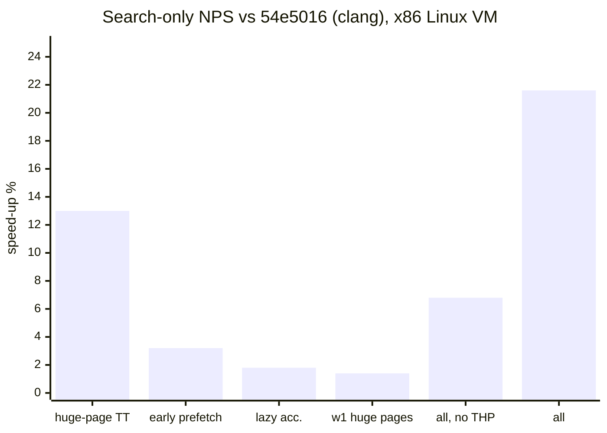

# NPS audit, 2026-11

An audit of where single-thread search time goes, looking for speed that
earlier work missed. Everything that shipped on this branch is **node-identical**:
bench 672,025 before and after, the d14 ladder exact, and the retained-TT probe
unchanged at 2,197,716. A speed change still owes a timed A/B before its Elo
can be banked, and none has been run yet.

**Headline (x86 Linux VM, clang 18, vs `54e5016` built with clang):**

| Instrument | Result |
|---|---|
| Cold-TT bench, search-only NPS (40 pairs) | **+21.6% ± 1.4%** |
| Warm-TT game bench, identical moves (20 pairs) | **+21.1% ± 1.3%** |
| Game bench vs `54e5016` built the way a bare `make` built it (gcc, 12 pairs) | **+31.9% ± 2.0%** |
| Same code without huge pages, which is what macOS gets (cold 40 / game 16 pairs) | **+6.8% ± 1.6% / +7.9% ± 1.0%** |
| Instructions per node (callgrind) | **3,083 -> 2,877 (-6.7%)** |

## 1. Machine and method

| | |
|---|---|
| CPU | 4 vCPU Intel Xeon @ 2.1 GHz (AVX-512 VNNI), 260 MiB shared L3 |
| OS | Linux 6.18 VM, THP mode `madvise`, no hardware perf counters |
| Toolchain | clang 18.1.3 (clang 19.1.1 and gcc 13 for comparisons), Python 3.13 |

This host is noisy. An A/A run of identical builds shows about 7.5% spread per
round, because the 260 MiB L3 is shared with other tenants, so whether the
192 MiB TT stays cached depends on the neighbours. Four instruments were used:

1. **Bench signature** (`cuci.py bench`, 672,025 nodes) as the node-identity
   gate. Every kept change also passes the NNUE verify mode (every incremental
   accumulator re-derived from scratch, 0 mismatches over 401,790 updates) and
   the full `selftest.py` (65 PASS; the one FAIL is `scipy` missing on this box,
   and it fails the same way on the baseline).
2. **Paired concurrent timing.** Baseline and candidate run at the same time
   on cores 2 and 3, swapped each round. Each process runs the six bench FENs
   at depth 11 three times and takes the median. TT wipes are excluded from the
   time (see 6.1). Reported as mean ratio ± standard error over n rounds.
3. **Game bench.** Self-play from two openings, 30 moves each, a fixed
   120,000 nodes per move, 192 MiB TT carried across moves. Node-identical
   builds play the same games (checked by hashing the move list), so the
   time ratio is a pure speed ratio with a warm table, closer to real play.
4. **callgrind instructions per node** (an `x86-64-v3` build, since valgrind
   has no AVX-512) for changes too small to resolve on the clock, and
   `perf record -e cpu-clock` for line-level profiles.

## 2. Where the time goes

Share of search time (perf, current head, bench workload; the TT wipes and
Python are excluded):

| Function | Share | Note |
|---|---|---|
| negamax | 26.6% | ~70% of its samples sit on the child TT prefetch and the TT probe |
| qsearch | 15.7% | ~70% on the TT probe (57%) and the child prefetch (12%) |
| stager_next | 7.5% | ~37% of it is the insertion sort |
| nn_tail | 7.4% | 16x528 -> 32 -> 1 int8 layers, AVX2+VNNI kernel |
| see | 6.0% | |
| mobility_king_safety | 5.0% | HCE, qsearch stand-pat only |
| nn_push_apply | 3.4% | accumulator deltas (lazy since this audit) |
| gen_noisy / gen_legal / gen_quiets / gen_captures | 10.2% | |
| apply_move | 2.2% | |
| nn_attack_union + nn_acc_refresh_persp + nn_forward | 4.7% | |
| everything else | ~11% | |

**The search is memory-bound on the TT.** On this host, the probe and its
prefetch account for roughly a third of all search time. Every change below
that paid on the clock either reduced that latency or moved work out of its
shadow.

## 3. What shipped on this branch

| Commit | Change | Instr./node | Timed (paired) |
|---|---|---|---|
| `81ebf45` | **Makefile: `CC ?= clang` never applied.** make predefines `CC=cc`, so `?=` saw it as set and a bare `make` built with gcc. Now it replaces only make's built-in default. | -- | clang is **+9.0% ± 1.8%** faster than the gcc build (20 pairs) |
| `8597938` | **TT on 2 MiB transparent huge pages** (Linux). Aligned + `madvise(MADV_HUGEPAGE)`; 192 MiB = 96 huge pages instead of 49,152 small ones, so the TLB walk disappears from most probes. macOS is unchanged. | -- | **+13.0% ± 2.6%** (8 sequential pairs) |
| `e3d0fee` | **Lazy NNUE accumulator.** 54% of eager pushes (225k of 418k on the bench) were never read: the child went straight to qsearch, cut on the TT, hit a draw, or used the lazy/TT eval. Pushes now record `(parent, child, move)` and `nn_eval` materialises pending slots on first read. | **-8.0%** | +1.8% ± 2.2% (hidden behind TT misses here) |
| `6f4fbe3` | **Prefetch the child TT entry before `apply_move`.** The key is derived from the move word (`key_after_approx`); the old post-make prefetch still fires when castling/ep make the real key differ. | +2.5% | **+3.2% ± 1.3%** (40) |
| `72c5717` | **`stager_next` reads history through the Stager.** In a dlopen'd `.so` the ~310 KB of `__thread` state costs a `__tls_get_addr` call per function entry; `stager_next` made 992,641 of the bench's ~2.4M such calls. | **-1.0%** | below resolution |
| `2c119dc` | **NNUE `w1` (3 MiB) on huge pages too**, through a shared `hp_alloc`. | -- | +1.4% ± 1.0% (80, not significant) |
| `b361793` / `86e5dea` | FI-115 stamp fix, **reverted** -- see 4. | | |
| `6439b04` | **Keep the snapshots building.** Every `Old Engine` snapshot from 51 on includes the *live* `NNUE/nnue.c`. `2c119dc` broke their compile (`hp_alloc`), and the lazy scheme would have mis-evaluated their direct null-move slot copy. Both features are now opt-in macros (`NN_LAZY_ACC`, `NN_HP_ALLOC`) defined only by the live `csearch.c`; snapshots 55-65 bench node-for-node identical to a build against `54e5016`'s `nnue.c` (11/11). | -- | -- |

What to expect on the reference Mac: the huge-page changes do nothing there
(no THP), so that machine gets the code-only part. Lazy accumulation is the
piece most likely to show more there than here, because Apple silicon's lower
memory latency leaves less for the saved work to hide behind.

## 4. A bug that was already known: the FI-115 stamp

FI-115 stamps each TT entry with a piece count so `qs_tt_store` can evict
entries holding more men than the root. The stamp comes from the per-thread
`g_node_pc`, which is written on node **entry** but read at the node's
**post-search** store, after every descendant has overwritten it. Instrumented
on the bench: **43.3% of stores (130,302 of 301,202) carry a wrong stamp, on
average 1.75 men too low.** Too low never evicts a live entry, but it hides
dead ones, so the rule fires less than designed.

I fixed it (`b361793`) and then found the history: the same mis-stamp was
found on 2026-08-29 (75.9% on the shipped build then). It was fixed in
`bd101fd` + `7c490f0`, but bundled with extending the victim rule to the
negamax and null-move stores. That bundle measured **ACCEPT H0, LLR -5.98**
and was reverted for v63, and `selftest.py`'s retained-TT probe pins the
shipped rule. My fix moved that pin (2,165,125 against 2,197,716), so it was
reverted in `86e5dea`.

**Not run as a solo A/B, on purpose.** `NNUE/shims/engine_b06_pcstamp.py`
already records the owner's call: a stamp-only run "would price neither the
bug nor the fix", because with correct tags the rule still covers only the
qsearch store. I disagree a little. A stamp-only run is a well-defined
question: does the *shipped* qsearch rule pay more with correct tags? But it
is the owner's call, and it can't be settled on this box anyway. Resolving a
few Elo needs ~10,000 games, and with two engines per game on 4 vCPUs that
is 30+ hours at 10+0.1. If it is ever run: pass `node_pc` into the three
store helpers (the reverted `b361793` is the patch) and run it at 192 MiB,
50+0.5, against this branch. Removing `g_node_pc` would also save ~300k TLS
calls per bench.

## 5. Tried and dropped

| Idea | Result | Why it lost |
|---|---|---|
| clang PGO | +1-3%, inside noise | |
| LTO (`-flto`) | instr. +1.2% | more inlining, no time gain |
| `-Wl,-Bsymbolic` | instr. unchanged, time in noise | PLT/GOT not on the hot path |
| clang 19 vs clang 18 | -2.4% ± 1.2% | |
| TLSDESC (`-mtls-dialect=gnu2`, clang 19) | +1.8% ± 1.1% over clang 19 | still below clang 18, and clang 18 can't emit it |
| Finny-table king refresh | instr. +0.7% | after lazy updates, king refreshes are already rare |
| 512-bit VNNI layer-1 kernel | **-5.7% ± 1.3%** | 512-bit ops cost more than they save at this size |
| `-mprefer-vector-width=512` | **-6.6% ± 1.2%** | same |
| Sparse-input layer 1 (skip zero chunks) | not built | 143,744 real inputs: 59.9% zero bytes, but only 12.0% of 4-byte chunks are all-zero; reordering neurons (greedy co-zero grouping, held-out) reaches 34.4%. With 16 outputs a skipped chunk saves 2 VNNI ops, while finding non-zero chunks costs about as much -- this needs a net trained for sparsity (nets trained for it reach ~80-90%), not a kernel |
| Per-thread context pointer (no `__tls_get_addr`) | upper bound **+0.8% ± 1.2%** | measured by making every `__thread` a plain static (single-thread only): instr. -1.2%, time not significant -- the refactor can't pay |
| TT buckets | not built | at 192 MiB and 1.5M nodes/move only 2.25% of stores overwrite a live current-search entry (depth >= 4: 0.004%); even at 24 MiB it is 10.8% / 0.05%. The upside would be keeping old-generation entries (46.7% of stores), the FI-115 territory that already tested negative when extended |
| Fixed-width (`h == 256`) NNUE loops | instr. -0.7% | |
| Pawn-structure cache | instr. -0.8% | would also need invalidating on every eval-param sync |
| Packed 64-bit key stager sort | instr. +0.9% | same branch pattern, more packing work |
| Incremental x-ray SEE | instr. -0.2% | most exchanges are 1-2 captures deep |
| TTEntry padded to 32 B (no line straddle) | -1.4% ± 1.3% | 256 MiB fits the shared L3 worse |
| Prefetch every qsearch capture child after ordering | +0.4% ± 1.7% | |
| Magic attack tables on huge pages | -1.0% ± 1.2% | the 2.25 MiB tables stay hot anyway |

## 6. Checked, nothing to fix

| Area | Finding |
|---|---|
| SMP scaling | 1 / 2 / 4 threads: 2.33M / 4.46M / 8.79M nps (1.91x, 3.77x). No contention. |
| Python driver | at 100 ms/move, 3.39 s of 3.45 s is inside the C search: ~1.7% overhead |
| Snapshot builds | 55-65 build and bench identically to `54e5016` (after `6439b04`). **51-54 have not compiled since E-04 (`683c2aa`, 2026-09-11)**: `nnue.c` reads `Board.a_ph`, which only exists from v55, and `setup.sh` hides the error behind "(skip ...)". Pre-existing; not fixed here. |
| Timed smoke match | branch vs `Old Engine/65`, 120 games at 10+0.1 (UHO, seed 65, 2 workers): 36W / 55D / 29L, **+20.3 ± 39.7 Elo**, ptnml 1/15/23/18/3. Endings: 28 threefold, 79 adjudicated, 4 material, 9 max-plies -- **no time losses, crashes or illegal moves**. A smoke test only: the error bar is ~10x what a few-Elo change needs. |

### 6.1 The bench NPS understates search speed

`run_bench` times six `cs_tt_reset()` calls, each a 192 MiB memset, together
with the searches. On this host the wipes were ~26% of bench wall time, so a
real 10% search speed-up shows as ~7% on the `bench` line. The node signature
is unaffected. Changing what the line measures would break comparison with
every recorded value, so it is left alone. When the NPS figure matters, time
the searches only.

## 7. What is left

Everything above was either shipped, measured and dropped, or bounded. Three
things remain, and none of them can be done on this box:

1. **The timed Elo A/B the speed changes owe**, ideally on the reference Mac.
   The huge-page part is Linux-only, and the lazy accumulator may show more
   on Apple silicon than here.
2. **The FI-115 stamp-only A/B**, if the owner wants it after all (section 4).
3. **A sparsity-regularised net**, which is the only route to a cheaper
   layer 1 (section 5).
